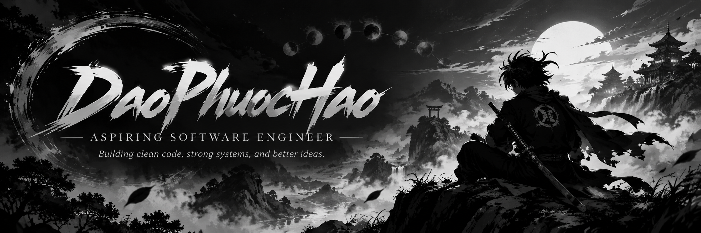
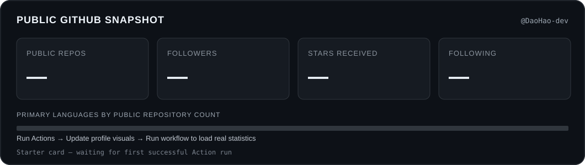
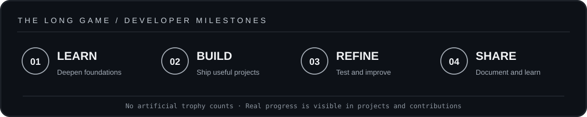
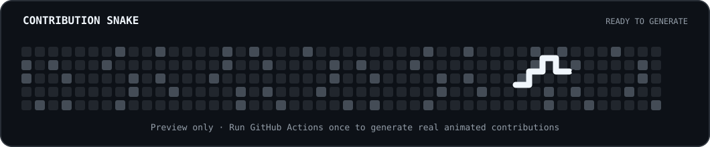

<div align="center">



<br />


<br />

### Third-year IT Student &nbsp;·&nbsp; Aspiring Software Engineer &nbsp;·&nbsp; Vietnam

**Learn deliberately. Build thoughtfully. Improve continuously.**

[**PROFILE**](https://github.com/DaoHao-dev) &nbsp;•&nbsp; [**REPOSITORIES**](https://github.com/DaoHao-dev?tab=repositories) &nbsp;•&nbsp; [**GITHUB ACHIEVEMENTS**](https://github.com/DaoHao-dev?tab=achievements)

</div>

---

## 01 — About

```text
> whoami
  Alias       : DaoHao-dev
  Focus       : Software engineering & practical development
  Current     : Year 3 · Information Technology
  Approach    : Understand the problem → design → build → improve
```

I'm a third-year Information Technology student interested in the engineering decisions behind dependable software. I enjoy exploring programming fundamentals, solving problems, and creating practical tools that make complex tasks simpler.

My current direction is to strengthen core computer science knowledge while getting more experience with **software development, automation, systems, and debugging**. I value clear documentation, maintainable code, and steady progress over flashy claims.

> “Consistency compounds. Small improvements, committed daily.”

## 02 — What I'm Exploring

| Area | Learning focus |
|:--|:--|
| **Programming** | Algorithms, problem solving, object-oriented principles |
| **Software engineering** | Code organization, testing, debugging, clean design |
| **Data & systems** | Databases, networking fundamentals, system behavior |
| **Developer workflow** | Git, GitHub, documentation and automation |
| **Curiosity zone** | Desktop tools, game servers and modded environments |

**Topics & tools on my radar:** 
<!-- DAOHAO-DEV | ENGINEERING ARSENAL — START -->
<div align="center">
  <h2>ENGINEERING ARSENAL</h2>
  <sub>Languages &bull; Frameworks &bull; Infrastructure &bull; Security &bull; Tools</sub>
  <p><em>Building, experimenting and continuously learning.</em></p>
  
</div>


<table align="center"><tr>
  <td></td>
  <td></td>
  <td></td>
</tr></table>

<h3>Explore the toolkit</h3>
<p>Grouped by domain to keep the profile readable. The expanded lists include tools I use, study or explore — not a claim of expert-level mastery.</p>

<details open>
  <summary><b>01 / Programming Languages</b> &nbsp; <sub>18 technologies</sub></summary>
  <br>
  <p align="left">
    
  </p>
</details>

<details>
  <summary><b>02 / Frontend &amp; UI</b> &nbsp; <sub>16 technologies</sub></summary>
  <br>
  <p align="left">
    
  </p>
</details>

<details>
  <summary><b>03 / Backend &amp; APIs</b> &nbsp; <sub>16 technologies</sub></summary>
  <br>
  <p align="left">
    
  </p>
</details>

<details>
  <summary><b>04 / Database &amp; Storage</b> &nbsp; <sub>12 technologies</sub></summary>
  <br>
  <p align="left">
    
  </p>
</details>

<details>
  <summary><b>05 / Cloud, DevOps &amp; Infrastructure</b> &nbsp; <sub>16 technologies</sub></summary>
  <br>
  <p align="left">
    
  </p>
</details>

<details>
  <summary><b>06 / Linux &amp; Security Environment</b> &nbsp; <sub>12 technologies</sub></summary>
  <br>
  <p align="left">
    
  </p>
  <p><b>Security research & learning:</b></p>
  <p>
    
    
    
    
    
    
    
    
    
  </p>
</details>

<details>
  <summary><b>07 / Developer Tools &amp; IDEs</b> &nbsp; <sub>16 technologies</sub></summary>
  <br>
  <p align="left">
    
  </p>
</details>

<details>
  <summary><b>08 / Testing &amp; Automation</b> &nbsp; <sub>9 technologies</sub></summary>
  <br>
  <p align="left">
    
  </p>
</details>

<details>
  <summary><b>09 / AI, Data Science &amp; Computer Vision</b> &nbsp; <sub>8 technologies</sub></summary>
  <br>
  <p align="left">
    
  </p>
</details>

<details>
  <summary><b>10 / Desktop, Mobile &amp; Game Tech</b> &nbsp; <sub>10 technologies</sub></summary>
  <br>
  <p align="left">
    
  </p>
</details>

<br>
<div align="center">
  <sub>Curiosity over credentials. Practice over appearances. Progress over perfection.</sub>
</div>
<!-- DAOHAO-DEV | ENGINEERING ARSENAL — END -->

<sub>These are areas of study and exploration, not claims of professional proficiency in every technology.</sub>

## 03 — Selected Projects

<table>
  <tr>
    <td width="50%" valign="top">
      <h3>GOVN Launcher</h3>
      <p>A Windows launcher concept focused on simplifying game setup, modpack delivery, version management, and the player experience.</p>
      <p><code>Desktop tools</code> <code>Automation</code> <code>UX</code></p>
      <a href="https://github.com/DaoHao-dev?tab=repositories">Browse repositories ↗</a>
    </td>
    <td width="50%" valign="top">
      <h3>GoVN RPG Server</h3>
      <p>A custom Minecraft server project exploring scripting, configuration, server administration, performance, and gameplay systems.</p>
      <p><code>Scripting</code> <code>Servers</code> <code>Troubleshooting</code></p>
      <a href="https://github.com/DaoHao-dev?tab=repositories">Browse repositories ↗</a>
    </td>
  </tr>
</table>

<sub>Personal projects in progress. Individual repository links can be added once published.</sub>

## 04 — GitHub Snapshot

<div align="center">



<sub>This panel is generated from public GitHub API data by the included workflow. It shows a clean placeholder until the first successful run.</sub>

</div>

## 05 — Milestones & Achievements

<div align="center">



[See my official GitHub achievements →](https://github.com/DaoHao-dev?tab=achievements)

</div>

<sub>Replaces the unreliable external trophy image. Milestones above describe goals, not unlocked GitHub awards.</sub>

## 06 — Contribution Snake

<div align="center">

<picture>
  <source media="(prefers-color-scheme: dark)" srcset="assets/github-snake-dark.svg" />
  <source media="(prefers-color-scheme: light)" srcset="assets/github-snake.svg" />
  
</picture>

<sub>First run: <b>Actions → Update profile visuals → Run workflow</b>. After a successful run, the static starter image is replaced with the real animated Snake.</sub>

</div>

## 07 — Next Chapters

- [ ] Publish a project with clear setup instructions and screenshots.
- [ ] Build better habits for testing, code reviews, and documentation.
- [ ] Explore a backend framework and build a small production-style API.
- [ ] Keep improving fundamentals: algorithms, databases, and system design.

---

<div align="center">

**Thanks for stopping by.**

<sub>© DaoHao-dev · Built to learn, engineered to last.</sub>

</div>
