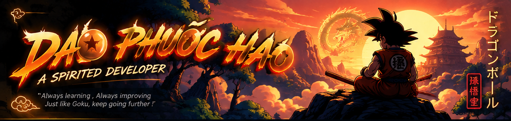
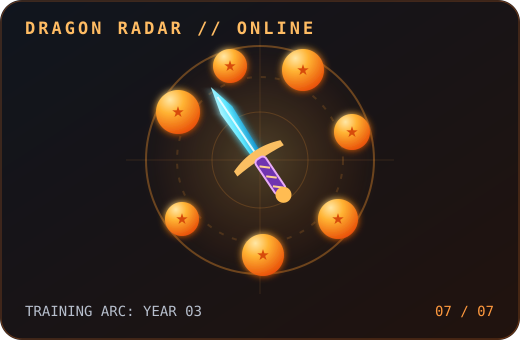

<!-- Original Dragon Ball-inspired banner created for this GitHub profile. -->

 

 

---

<h2>⚡ SCOUTER REPORT · ABOUT ME</h2>

<table>
<tr>
<td width="59%" valign="top">

### Hi, I'm Hào! 👋

I'm a **third-year Information Technology student** in Vietnam, building a solid foundation in computer science while turning ideas into practical projects.

- 🎓 **Current arc:** Studying IT, strengthening core engineering principles.
- 🧠 **Core interests:** Programming, data structures, algorithms, databases, and software design.
- 🛠️ **I like building:** Developer tools, automation scripts, and systems that solve real problems.
- 🎮 **Side quests:** Minecraft modding, server customization, and game-related software.
- 🚀 **Next mission:** Grow into a versatile, thoughtful software engineer.

> *"Great developers aren't born with a power level. They earn it with every problem they solve."*

</td>
<td width="41%" align="center" valign="middle">

</td>
</tr>
</table>

<h2>🛠️ MY TECH TRAINING GROUND</h2>

**Areas I'm studying and exploring — not a claim of mastery.**

**Programming & Web**

**Developer Tools & Platforms**

**Exploring next**

 

`Problem Solving` · `OOP` · `Data Structures & Algorithms` · `Database Fundamentals` · `System Design Basics`

<b>📚 Show my current learning roadmap</b>

 

| Training quest | What I'm working toward |
| --- | --- |
| 🥋 Foundations | Stronger algorithmic thinking, OOP, and clean code |
| ⚙️ Backend | Building APIs and understanding data flow |
| 🗄️ Data | Designing schemas and working with SQL |
| 🧰 Tools | Version control, debugging, and automation |
| 🧪 Engineering | Testing, documentation, and maintainable software |

 

<h2>🚀 FEATURED SIDE QUESTS</h2>

<table>
<tr>
<td width="50%" valign="top">

### 🖥️ GOVN Launcher

A Windows launcher project designed to simplify Minecraft setup, modpack management, and updates.

**What I explore:** desktop tooling, file management, configuration, and user experience.

</td>
<td width="50%" valign="top">

### ⛏️ GoVN RPG Server

A modded Minecraft server project focused on gameplay customization, configuration, and server-side automation.

**What I explore:** scripting, system administration, troubleshooting, and performance.

</td>
</tr>
</table>

> 🧭 **Project status:** These are personal projects in development. Replace the repository-list links with their real repository URLs once published.

<h2>📊 BATTLE STATS · GITHUB ACTIVITY</h2>

 

 

<b>🏆 Show GitHub trophies</b>

 

 

<h2>🐉 CONTRIBUTION QUEST · SNAKE ANIMATION</h2>

<!-- This animation starts working AFTER you run the included GitHub Action and it creates the output branch. -->
<picture>
  <source media="(prefers-color-scheme: dark)" srcset="https://raw.githubusercontent.com/DaoHao-dev/DaoHao-dev/output/github-snake-dark.svg" />
  <source media="(prefers-color-scheme: light)" srcset="https://raw.githubusercontent.com/DaoHao-dev/DaoHao-dev/output/github-snake.svg" />
  
</picture>

🐍 Enable this by uploading <code>.github/workflows/snake.yml</code> and running it from the Actions tab. It updates automatically every day.

 

<h2>🎯 THE NEXT TRAINING ARC</h2>

<table>
<tr><th>01 · LEARN</th><th>02 · BUILD</th><th>03 · IMPROVE</th></tr>
<tr><td>Deepen CS fundamentals</td><td>Ship real, useful software</td><td>Refactor, test, and document</td></tr>
</table>

### ✨ "Every commit is another step toward the next transformation."

Made with curiosity, caffeine, and seven Dragon Balls. 🟠

**Thanks for visiting my developer journey!**

